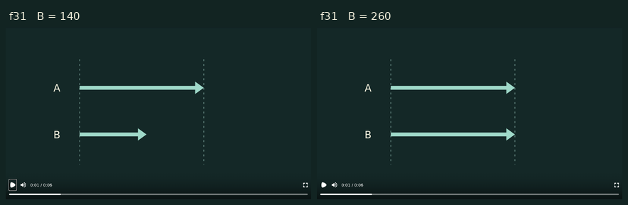
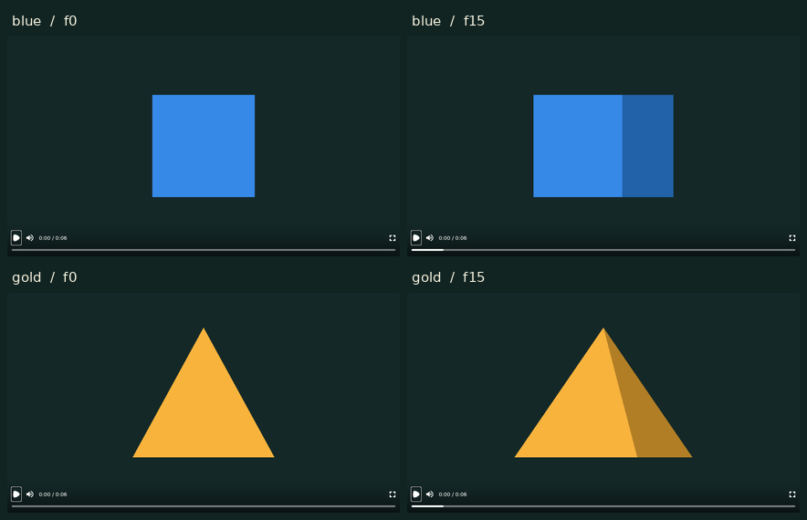
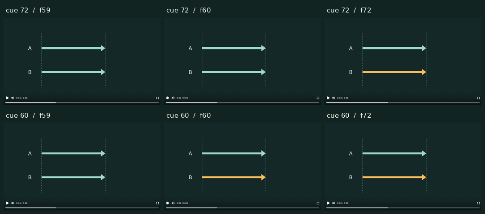

# 在一镜里试一处修改

三个例子供导演和组件作者在改稿时查阅。案例一、三共用一个二维组件，案例二用自包含模型。所有素材随例提供。文字、构图、题材和选用的组件都可以自行决定。

## 运行

从本仓根目录，用 Node 22.12+、npm、pnpm 和 sh 创建一个空工作区。脚本调用正式发布的 `create-promptframe-component@0.1.73`，生成 `diagram` 和 `model`，复制本例源码和蓝色模型。生成的 CLI 为 0.1.88，component-kit 为 0.1.45。平台使用其它版本时从项目入门查看兼容发行。

```sh
sh examples/director-revisions/create.sh ../revision-demo
cd ../revision-demo
pnpm install
pnpm --dir components/diagram run validate
pnpm --dir components/model run validate
pnpm --dir components/diagram dev
```

单组件开发页可在参数区修改预览值。看它与原片字幕、其它图层的关系时，从工作区运行 `pnpm exec promptframe dev . --studio-origin "$STUDIO_ORIGIN"`，其中环境变量为实际 Studio 网页的 origin。导演通过已授权的开发连接，将组件用于目标页的一镜。自己的组件可直接从脚手架起步；已经定稿的素材、实拍或依赖专业离线渲染的镜头也可直接编排进原片。

## 改画面

**委托。** 让 A、B 两个箭头表示相同的量，保留原字幕和机位。

打开 `diagram`，停在镜头内第 31 帧。上箭头的长度为 260，下箭头的 `lowerLength` 初值为 140。将它改成 260，观察下箭头尖端抵达和上箭头相同的竖虚线。若修改的是组件源码，在开发连接回报该页已采用新代码后再取同一帧。若是现有参数就直接改参数。这个改动与二维或三维技术无关。



放进作品后，先从时间线读镜头起点。例中镜头从第 0 帧、1 倍速开始。若它从作品第 900 帧开始，以相同速度播放第 31 帧，采样传作品第 931 帧。已保存的正式引用用 `render_contact_sheet` 的 `source=server`。本地开发或混合预览先从 `studio_preview` 读准目标页、采用版本与节点，再对同一组帧号指定 `source=studio_preview`、`pageId` 和 `expectedVersion`。沿目标页的原生共享授权取图。每次检查记录来源和回执，图中仍是旧箭头时检查采用版本。

## 换模型

**委托。** 同一机位转过同样角度，比较方块和尖顶轮廓。使用 `fixtures/blue.glb` 和 `fixtures/gold.glb`。本例的模型组件专用于这两个纯色、无贴图的网格。导演也可以用自己有权且声明了模型槽的正式组件。

将蓝色样本复制为开发目录中的 `selected.glb`。在生成的工作区运行以下命令，文件路径改为该选定文件的实际路径。

```sh
pnpm exec promptframe resource set ./components/model --prop /model --file "$SELECTED_GLB" --watch
pnpm exec promptframe dev . --studio-origin "$STUDIO_ORIGIN"
```

1. 在目标作品的 `studio_preview` 读实际页面、连接的 `localModels` 和节点的 `modelSlots`。用 `bind_model_resource` 传本次读到的页面版本、连接、节点、参数、组件、资源标识和摘要。命令受理后，再读实际应用结果。
2. 在相同的两个作品帧采样。例如镜头从 0 开始，就用 `frames:[0,15]`。帧 0 正视，帧 15 转过 30°。将选定文件内容换成金色样本，核对新的文件摘要、绑定与页面实际采用记录，按当前身份补绑定，再取同两帧。预期是蓝方块和金色尖顶各两张，有效换版期间素材登记 0 次。
3. 需要恢复就 `clear_model_resource`。需要采用才核对最终文件，沿现有素材上传、就绪回执和作品保存流程写入正式引用。可复用已有就绪素材。服务端采同两帧验证正式结果。组件包和模型文件可分别换版。



Admin「预览与调参」也能由用户选择图片、音频、视频和 GLB，在本页看效果。作品内 Agent 经开发连接临时换文件，当前已验的种类是自包含 GLB。本条的回执与参考画面均只针对模型。

## 改节奏

**委托。** 在听到第二个词 “Now” 时点亮 B 箭头。随附的 [4 秒原声](fixtures/hold-now.wav) 在第 2 秒放入 “Now” 的语音片段。案例的已知放置时刻来自音轨制作。初稿 `cueFrame=72` 在 30 fps 下迟 0.4 秒，将其改为 60。取镜头内的 59、60 和 72 帧，两版都在 59 帧呈青色，60 帧只有新稿变金，72 帧两版都已变金。



在作品中把同一条原声放在相同位置，保留字幕，循环听看切点附近两秒。拼图回答颜色哪一帧改变，带原声的回放可以判断词和视觉动作合不合拍。只有现成音频时，可播放音频人工核对。本例没有为这份 WAV 申请 ASR。

对已有 TTS，先读当前音轨及词时间的来源、精度。普通说明可直接用估时。确实需要卡词且只有估时，再用该音轨与原稿请求当前项目开放的词对齐。只采用核过原音轨、单调且落在时长内的被接受结果，再绑定字幕及动作；多字词的词时间只精确到这个词。缺可用对齐或有歧义时，可直接选明确的帧或保留估时标记。换语速后再核同一处切点。

## 素材或数据从哪里来

| 输入 | 进入一镜的方式 |
| --- | --- |
| 数值、标签、采样点 | 作为经过 schema 校验的 props，多个图层读同一份值。 |
| 随组件发布的小图或固定示例 | 放到包的 public 目录，通过 `promptFramePublicResource` 等公开 helper 取用。GLB 使用受控的模型读取和准备接口。 |
| 作品里的图片、音视频或模型 | 在 schema 声明相应媒体槽，用已授权的稳定素材引用，读取已准备好的媒体；模型用 `usePromptFrameModel`。最终作品只保存可正式渲染的引用。 |
| API 返回的数据、外部网址里的媒体 | 导演在准备素材时沿有权限的来源获取和校验，冻结本次使用的数据或登记媒体。画面逐帧从 props 和媒体槽读取，无需在组件里发 HTTP 请求。凭据和签名地址留在原有授权流程里。 |

已有素材何时适合采用、如何绑定项目引用与处理缺失，见[作者手册](../../AUTHORING.md#素材引用槽与本地私有预览)。这些示例图来自脚手架中的本地画面；在作品里核对字幕、临时来源或正式输出时，以对应版本的实际回执及像素为准。
